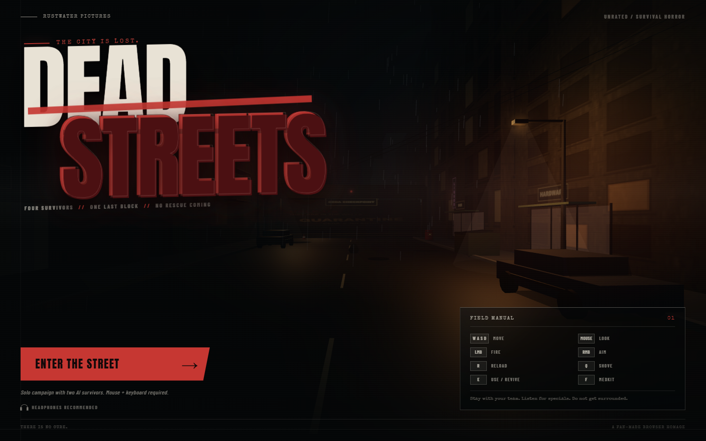

# DEAD STREETS

A Left 4 Dead-inspired zombie survival FPS that runs in the browser. Push through a rain-soaked city block with two AI survivors, survive CEDA barricade hordes, bring the evac generator online, and reach the shelter before the street overruns you.



## Play

```bash
npm install
npm run dev
```

Open the local URL printed by Vite (usually `http://localhost:5173`).

Click **Enter the Street** to begin. Mouse capture is required for aiming. The game is designed for desktop Chrome, Edge, or Firefox with mouse and keyboard.

## Features

- A complete three-sector campaign run built around hordes, checkpoints, and a final holdout
- Two AI-controlled survivors, Rook and Mara, who fight, follow, call out threats, and can revive you
- Common infected plus runners, acid-spitting Spitters, and a heavily armored Brute
- Assault rifle, pump shotgun, and sidearm with distinct handling, spread, recoil, and reload timings
- Melee shove, pipe bombs, explosive barrels, medkits, and supply caches
- L4D-style HUD with squad health, director threat, hitmarkers, killfeed, damage direction, and finale timer
- Procedurally built city block, wet streets, neon signs, streetlights, rain, fog, and a fully procedural soundscape
- No external art or audio assets — the world, weapons, characters, and sounds are generated at runtime

## Controls

| Input | Action |
| --- | --- |
| `W A S D` | Move |
| Mouse | Look |
| `LMB` | Fire |
| `RMB` | Aim down sights |
| `Shift` | Sprint |
| `Space` | Jump |
| `R` | Reload |
| `Q` | Shove |
| `1` / `2` / `3` | Rifle / Shotgun / Pistol |
| `E` | Use supplies, start the generator, hold to revive |
| `F` | Use medkit |
| `G` | Throw pipe bomb |
| `M` | Mute audio |
| `Esc` | Pause |

## Run Objectives

1. Push to the CEDA checkpoint and survive the first horde.
2. Cross the market and clear the second barricade.
3. Start the shelter generator and hold out until the evac door powers open.
4. Reach the extraction marker.

## Tech

- [Three.js](https://threejs.org/) for rendering
- [Vite](https://vite.dev/) for the dev server and production build
- Web Audio API for all sound design
- Canvas-generated textures for signs, facades, blood, fire, and glow effects

```bash
npm run build
npm run preview
```

This is a fan-made homage. It contains no assets or code from Left 4 Dead or Valve.
