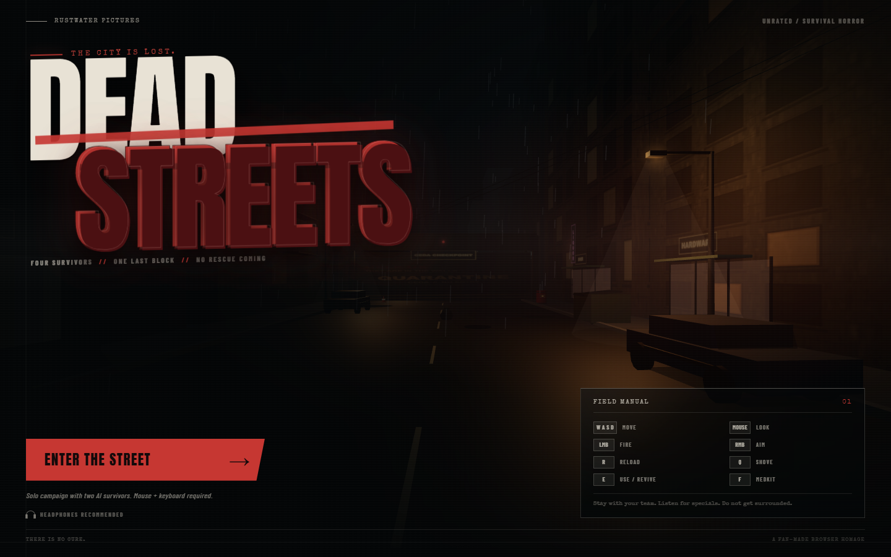

# DEAD STREETS

A Left 4 Dead-inspired zombie survival FPS. Push through a rain-soaked city block with two AI survivors, survive CEDA barricade hordes, bring the evac generator online, and reach the shelter before the street overruns you.

Runs in the browser, installs as a PWA, and ships as a Windows desktop app (Electron) for Steam.



## Play

```bash
npm install
npm run dev
```

Open the local URL printed by Vite (usually `http://localhost:5173`).

Pick a difficulty (**Civilian / Survivor / Nightmare**), click **Enter the Street** to begin. Mouse capture is required for aiming. The game is designed for desktop Chrome, Edge, or Firefox with mouse and keyboard.

## Features

- A complete three-sector campaign run built around hordes, checkpoints, and a final holdout
- Three difficulties with persisted selection: zombie health/speed and spawn pacing scale up
- Two AI-controlled survivors, Rook and Mara, who fight, follow, call out threats, revive you when downed, and rejoin after wave clears if they die
- Downed players can crawl to a teammate and hold-revive them — full-team wipes are recoverable
- Common infected plus runners, acid-spitting Spitters, and a heavily armored Brute
- Assault rifle, pump shotgun (9-pellet spread), and semi-auto sidearm with distance falloff, spread, recoil, and reload timings
- Animated CC0 allies (Quaternius soldiers) with procedural fallback when models are unavailable
- Blender-authored weapon viewmodels loaded at runtime from `public/models/`
- Melee shove, pipe bombs, explosive barrels, medkits, and supply caches
- L4D-style HUD with squad health, director threat, hitmarkers, killfeed, damage direction, and finale timer
- Pause menu with sensitivity, FOV, volume, and HIGH/LOW quality settings (all persisted); best-run tracking on the menu and end screen
- Procedurally built city block, wet streets, neon signs, streetlights, rain, fog, and a fully procedural soundscape
- Installable PWA with an offline service worker; portable Windows build via Electron (see below)

## Controls

| Input | Action |
| --- | --- |
| `W A S D` | Move |
| Mouse | Look |
| `LMB` | Fire |
| `RMB` | Aim down sights |
| `Shift` | Sprint |
| `Space` | Jump |
| `R` | Reload |
| `Q` | Shove |
| `1` / `2` / `3` | Rifle / Shotgun / Pistol |
| `E` | Use supplies, start the generator, hold to revive / recruit |
| `F` | Use medkit |
| `G` | Throw pipe bomb |
| `M` | Mute audio |
| `F11` | Toggle fullscreen (desktop app) |
| `Esc` | Pause |

### Controller

Standard layout, connected any time — Start/A also starts a run from the menu.

| Input | Action |
| --- | --- |
| Left stick | Move (full tilt sprints) |
| Right stick | Look |
| `RT` / `LT` | Fire / Aim |
| `A` / `B` / `X` / `Y` | Jump / Shove / Reload / Use + revive |
| `LB` / `RB` | Cycle weapons |
| `D-down` / `D-right` | Medkit / Pipe bomb |
| `Start` / `Back` | Pause / Mute |

## Run Objectives

1. Push to the CEDA checkpoint and survive the first horde.
2. Cross the market and clear the second barricade.
3. Start the shelter generator and hold out until the evac door powers open.
4. Reach the extraction marker.

## Tech

- [Three.js](https://threejs.org/) for rendering
- [Vite](https://vite.dev/) for the dev server and production build
- Web Audio API for all sound design
- Canvas-generated textures for signs, facades, blood, fire, and glow effects
- [Blender](https://www.blender.org/) 5.x for authoring the weapon viewmodel assets (`tools/make_rifle.py`, `tools/make_shotgun.py`, `tools/make_pistol.py`), exported to glTF via `public/models/`
- The animated zombie uses **"Male City Zombie" by Rikindle3D** (CC0) from OpenGameArt, retargeted onto its Mixamo skeleton with in-place walk/attack/death clips and loaded as `zombie.glb` (`tools/make_zombie.py`)
- Rook and Mara use **Quaternius Ultimate Animated Character Pack** (CC0) `Soldier_Male` / `Soldier_Female` loaded as `ally_rook.glb` / `ally_mara.glb` (procedural fallback when unavailable), mirrored via Cinevva CDN; world gun props from the Quaternius Zombie Apocalypse / Toon Shooter kits (`gun_rifle_q.glb`, `gun_shotgun_q.glb`, `gun_pistol_q.glb`)
- [Electron](https://www.electronjs.org/) + electron-builder for the portable Windows desktop build

This is a fan-made homage. It contains no assets or code from Left 4 Dead or Valve.

```bash
npm run build
npm run preview
```

## Desktop build (Windows, for Steam)

```bash
npm run dist
```

Produces a portable exe in `release/` (gitignored) via Electron + electron-builder. The app loads the local `dist/` bundle, so no server or internet connection is needed after install. The build is currently unsigned — sign the binary before any store submission. See `STEAM.md` for the store-submission checklist.

## Tech
